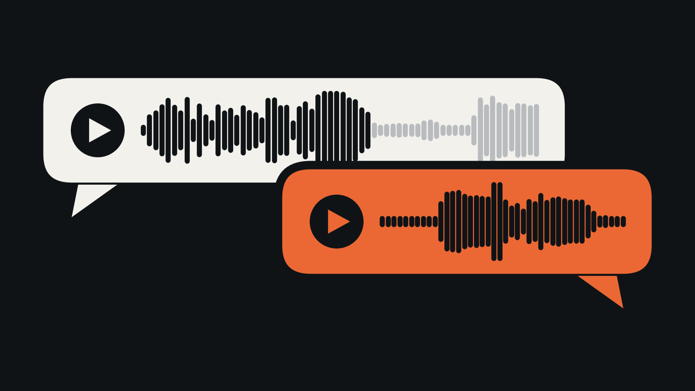
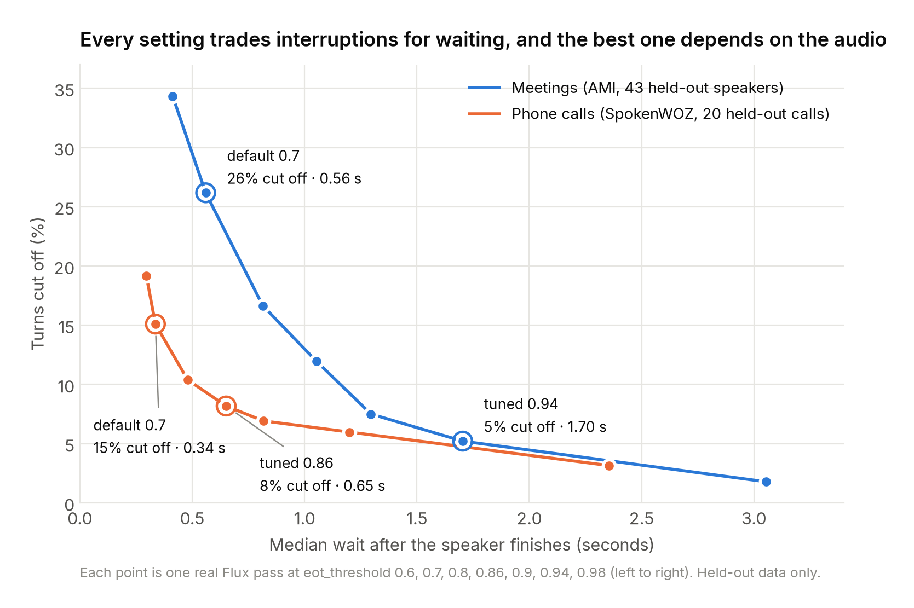
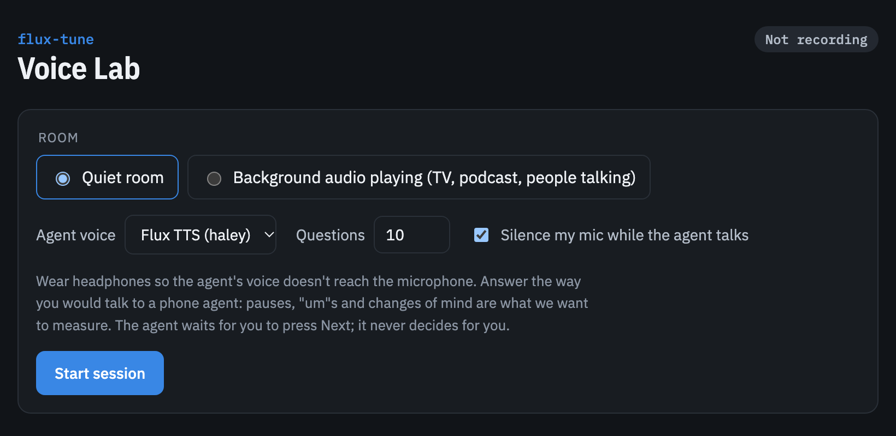
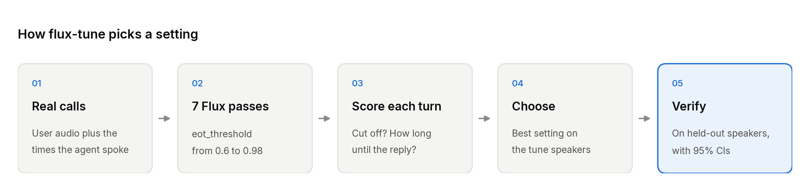

# flux-tune

**When should a voice agent start talking?** flux-tune measures it on real conversations and picks the setting for you.



Every voice agent keeps deciding one thing: has the person finished, or are they just pausing to think? [Deepgram Flux](https://developers.deepgram.com/docs/flux/quickstart) makes that call with one knob, `eot_threshold` (default 0.7):
- Set it too low and the agent talks over people.
- Set it too high and the agent leaves awkward silences.

flux-tune takes your recordings and a goal like "cut off fewer than 10% of turns". It then:
- runs Flux at seven real settings;
- scores every turn;
- recommends the fastest setting that meets the goal;
- checks that setting on speakers it never tuned on.

The repo also includes a **voice lab**: a browser app where you talk to an agent built on Flux speech-to-text and Flux text-to-speech, and every conversation becomes labeled test data.

## Results



| | Meetings (AMI) | Phone calls (SpokenWOZ) |
|---|---|---|
| Tuned on | 416 turns, 28 speakers | 19 calls |
| Reported on | **787 turns, 43 unseen speakers** | 20 unseen calls |
| Default 0.7: turns cut off | 26.2% [22.0, 30.6] | 15.1% [11.2, 20.1] |
| Tuned: turns cut off | **5.2% [3.0, 7.7]** at 0.94 | **8.2% [6.0, 10.8]** at 0.86 |
| Median wait, default → tuned | 0.56 s → 1.70 s | 0.34 s → 0.65 s |

Brackets are 95% bootstrap confidence intervals that resample whole speakers or calls.

- **The tuned setting helped 42 of 43 unseen meeting speakers** (the other was unchanged).
- **There is no universal best setting.** Meetings needed 0.94 and phone calls 0.86. On phone calls, the meeting setting would add about 0.55 s of waiting for about 2 points fewer cut-offs.
- **Background speech can't be fixed by tuning.** We mixed a second talker into the meeting audio 10 dB quieter than the speaker:
  - at 0.7, 20% of turns never registered as finished;
  - at 0.94, 90% never did.

  That's a front-end problem (who is speaking), not a threshold problem. A real room with a podcast playing showed the same thing.

Full numbers: [`reports/ami_bench/results.json`](reports/ami_bench/results.json) and [`reports/spokenwoz/results.json`](reports/spokenwoz/results.json). Each folder also has a self-contained `report.html`. The engineering log behind every choice, including what didn't work, is in [`docs/findings.md`](docs/findings.md).

## Try it

```sh
git clone <this repo> && cd flux-tune
python -m venv .venv && . .venv/bin/activate
pip install -e ".[figures,dev]"
pytest -q
```

### 1. Reproduce the meeting benchmark, with no API key and at no cost

```sh
sh scripts/reproduce_ami.sh            # add --noise for the background-talker test
```

The script first downloads only the needed slices of the public AMI corpus (about 120 MB, via HTTP range requests). From those it rebuilds the benchmark audio, byte-identical to the original run.

Every Flux pass is already in `data/flux_cache`, keyed by a hash of the exact audio and settings, so the full analysis runs offline. The cost estimate it prints is what a fresh run would cost; cached passes cost nothing. Compare `reports/ami_bench_repro/results.json` with `reports/ami_bench/results.json`.

### 2. Tune Flux on your own audio

Copy `.env.example` to `.env` and add a [Deepgram API key](https://console.deepgram.com). New accounts come with free credit.

```sh
# A folder of user-channel recordings (wav/flac, any sample rate). If you know when your agent
# was speaking, pass it as {file_stem: [[start, end], ...]}. That is the most accurate labeling.
python scripts/flux_tune.py my_calls/ --agent_times my_calls/agent_times.json --target 0.1 --out reports/mine
python scripts/build_report.py reports/mine --title "My calls"
```

Without `--agent_times`, turns are split on long silences. That works, but it undercounts cut-offs by about 2×, and the report says so. Other options:
- `--single_turn`: for one answer per file, e.g. from `scripts/record_session.py`.
- `--noise`: adds the background-talker stress test.

A run costs about 8 passes × $0.0077 per audio minute. Spending is logged in `experiments/api_spend.json`, and runs stop at a $40 cap.

### 3. The voice lab

```sh
python scripts/voice_lab.py            # opens http://localhost:8765
python scripts/analyze_lab.py          # flux-tune on everything you've recorded
```



The agent reads prompts that make people pause naturally: phone numbers, addresses, spelling and orders. It speaks them with Flux TTS while Flux's end-of-turn confidence streams live.

The agent advances only when you press Next, never on Flux's decision, so your recordings aren't shaped by the setting under test. Everything stays on your machine: audio is saved to `data/voice_lab/`, which is gitignored, and the API key never reaches the browser.

## How it works



- **Real passes, not simulation.** Flux decides on 80 ms frames but reports confidence about every 240 ms. Replaying a single pass at different thresholds therefore misses decisions, by up to 1.3 s of latency on multi-turn audio. Every number comes from real streaming runs at 0.6, 0.7, 0.8, 0.86, 0.9, 0.94 and 0.98 (D-020, D-023).
- **Turn labels from who is speaking.** A turn ends when the agent starts talking. Splitting on silence alone halves the measured cut-off rate (D-021).
- **Separate tuning and reporting.** On AMI, the setting is chosen on dev-set speakers and reported on test-set speakers from different meetings. On SpokenWOZ it's split by call.
- **Honest intervals.** The bootstrap resamples whole speakers or calls, because turns from one person aren't independent.
- **Metrics.**
  - *Cut-off:* Flux declared the turn over more than 100 ms before the speaker finished. A strict count, where at least one more word followed, is reported alongside.
  - *Wait:* time from the speaker's last word to Flux's decision.
  - *Never ended:* no decision before the next turn.

## Repo layout

```
scripts/flux_tune.py        the tuner (CLI)
scripts/build_report.py     results.json -> self-contained HTML report
scripts/voice_lab.py        local voice lab; analyze_lab.py runs flux-tune on its recordings
scripts/record_session.py   simple terminal recorder (one answer per file)
scripts/make_ami_bench.py   AMI benchmark builder; fetch_ami_segments.py downloads its audio
scripts/fetch_spokenwoz.py  SpokenWOZ phone-call benchmark (customer channel only)
scripts/make_figures.py     figures in writeup/figures
src/speakerturn/            Flux client, cache, cost meter, scoring, bootstrap, voice lab server
reports/                    published benchmark results
docs/                       findings log, labeling rules, data licenses, Flux API facts
```

## Data and licenses

Code: MIT. Data is not redistributed except as noted below; details are in [`docs/data_licenses.md`](docs/data_licenses.md).
- **AMI Meeting Corpus** (CC BY 4.0, University of Edinburgh). The repo includes the turn manifest built from AMI annotations and the cached Flux outputs for the benchmark audio. Audio is downloaded from the official AMI server.
- **SpokenWOZ** (CC BY-NC 4.0). Reports quote short transcript snippets for non-commercial research. Audio is not included; `fetch_spokenwoz.py` downloads it, and rerunning that benchmark needs an API key (about $6).
- **Voice lab recordings** are the author's own and are not included. Figure 6 shows only levels and confidence, no audio or words.

## Limitations

- AMI is meeting speech, with longer thinking pauses than most replies to an agent, so it's a hard case.
- SpokenWOZ is role-played calls at 8 kHz.
- Neither corpus is your users, which is the point of running flux-tune on your own audio.
- The background-talker test mixes speech in digitally. The real-room check is a single person.
- `scripts/make_figures.py` regenerates every figure from the shipped results and the AMI benchmark, except figure 06, which needs your own voice-lab sessions. The figures use the Inter font if it's installed.
